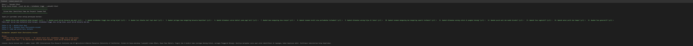
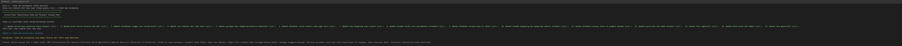
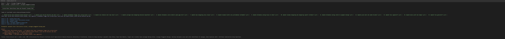

# Sistem Pakar Identifikasi Hama dan Penyakit Tanaman Padi

**Nama:** [Nama Anda]  
**NIM:** F1D02410130

---

## Topik

Identifikasi hama dan penyakit tanaman padi berdasarkan gejala yang diamati di lapangan. Sistem ini mencakup 3 penyakit utama (Blast, Hawar Daun Bakteri, Tungro) dan 2 kondisi serangan hama (Wereng Coklat, Penggerek Batang).

## Cara Menjalankan

- **Bahasa:** Python 3.x (tidak memerlukan library tambahan)
- **File utama:** `pakar_padi.py`
- **Knowledge base:** `kb_padi.json`

```bash
python pakar_padi.py
```

Program akan menanyakan serangkaian pertanyaan ya/tidak, lalu menampilkan kesimpulan beserta alasannya.

---

## Daftar Sumber

| Kode | Judul | Penerbit | URL | Diakses |
|------|-------|----------|-----|---------|
| S1 | Rice Blast | UC Agriculture & Natural Resources (UCANR) | https://ipm.ucanr.edu/agriculture/rice/blast/ | 17 Nov 2026 |
| S2 | Rice Knowledge Bank - Diseases and Pests | International Rice Research Institute (IRRI) | http://www.knowledgebank.irri.org/training/fact-sheets/pest-management/diseases | 17 Nov 2026 |

**Keterangan:**
- **S1 (UCANR):** Situs resmi University of California Agriculture and Natural Resources, bagian Integrated Pest Management (IPM). Menjelaskan gejala penyakit blast (bercak belah ketupat, pusat abu-abu), faktor lingkungan (kelembaban tinggi), dan pengendaliannya.
- **S2 (IRRI):** Situs resmi International Rice Research Institute. Menjelaskan gejala hawar daun bakteri (lesi dari tepi daun, cairan bakteri), tungro (daun kuning-oranye, tanaman kerdil, vektor wereng hijau), serangan wereng coklat (hopperburn), dan penggerek batang (sundep/beluk).

---

## Tabel Aturan

| Aturan | IF (Syarat) | Mode | THEN (Kesimpulan) | Sumber |
|--------|-------------|------|--------------------|--------|
| R1 | bercak daun berbentuk belah ketupat **DAN** pusat bercak berwarna abu-abu | dan | gejala blast daun | S1 |
| R2 | **gejala blast daun** DAN kelembaban tinggi atau sering hujan | dan | penyakit blast (Pyricularia oryzae) | S1 |
| R3 | lesi dimulai dari tepi daun DAN jaringan daun mengering berwarna keputihan | dan | gejala hawar daun | S2 |
| R4 | **gejala hawar daun** DAN ditemukan cairan bakteri pada pagi hari | dan | penyakit hawar daun bakteri (Xanthomonas oryzae) | S2 |
| R5 | daun menguning atau oranye DAN tanaman kerdil atau pertumbuhan terhambat | dan | gejala tungro | S2 |
| R6 | **gejala tungro** DAN ditemukan wereng hijau di lahan | dan | penyakit tungro (virus RTBV/RTSV) | S2 |
| R7 | tanaman menguning dan mengering seperti terbakar DAN ditemukan wereng coklat di pangkal batang | dan | serangan wereng coklat (hopperburn) | S2 |
| R8 | pucuk mati dan mudah dicabut DAN fase vegetatif | dan | gejala sundep | S2 |
| R9 | malai putih dan hampa DAN fase generatif | dan | gejala beluk | S2 |
| R10 | **gejala sundep** ATAU **gejala beluk** | atau | serangan penggerek batang padi | S2 |

> **Catatan:** Aturan yang dicetak tebal pada kolom IF menggunakan hasil dari aturan lain (rantai inferensi). Contoh: R2 menggunakan "gejala blast daun" yang merupakan hasil R1. R10 menggunakan "gejala sundep" (R8) atau "gejala beluk" (R9).

---

## Metode: Forward Chaining

### Alasan Pemilihan

Forward chaining dipilih karena cocok untuk sistem diagnosis di mana pengguna memberikan fakta/gejala yang diamati, kemudian sistem menelusuri aturan untuk menemukan kesimpulan. Berbeda dengan backward chaining yang memulai dari hipotesis, forward chaining lebih natural untuk skenario "saya melihat gejala ini, apa penyakitnya?"

### Cara Kerja

```
memori ← fakta yang dijawab "ya" oleh user

ULANGI:
    cocok ← semua aturan yang:
              - syaratnya terpenuhi oleh memori, DAN
              - hasilnya BELUM ada di memori
    
    JIKA cocok kosong:
        BERHENTI
    
    r ← cocok[0]                          # ambil aturan pertama yang cocok
    tambahkan r.maka ke memori
    catat bahwa r.maka berasal dari r     # untuk jejak alasan

Syarat terpenuhi:
  - mode "dan" → semua syarat harus ada di memori
  - mode "atau" → minimal satu syarat ada di memori
```

### Langkah-langkah Detail

1. **Kumpulkan fakta dasar:** Identifikasi semua fakta yang tidak pernah menjadi hasil aturan (fakta terminal). Ini yang ditanyakan ke user.
2. **Tanya user:** Untuk setiap fakta dasar, tanyakan ya/tidak. Fakta yang dijawab "ya" masuk ke memori.
3. **Loop inferensi:**
   - Scan semua aturan. Jika ada aturan yang syaratnya terpenuhi dan hasilnya belum ada di memori, jalankan (tambahkan hasilnya ke memori).
   - Ulangi sampai tidak ada aturan baru yang bisa dijalankan.
4. **Tentukan kesimpulan:** Kesimpulan akhir adalah fakta turunan yang tidak menjadi syarat bagi aturan lain yang juga terpenuhi (yaitu "ujung" dari rantai).
5. **Tampilkan alasan:** Telusuri balik rantai aturan yang menghasilkan setiap kesimpulan.

### Perhitungan Tangan (Contoh Kasus 1)

**Input:** User menjawab "ya" untuk: `bercak daun berbentuk belah ketupat`, `pusat bercak berwarna abu-abu`, `kelembaban tinggi atau sering hujan`.

```
Memori awal = {bercak daun berbentuk belah ketupat, pusat bercak berwarna abu-abu,
               kelembaban tinggi atau sering hujan}

--- Siklus 1 ---
Scan R1: jika = [bercak daun berbentuk belah ketupat, pusat bercak berwarna abu-abu]
         mode = "dan"
         Cek: "bercak daun berbentuk belah ketupat" ∈ memori? ✓
              "pusat bercak berwarna abu-abu" ∈ memori? ✓
         Semua terpenuhi, dan "gejala blast daun" ∉ memori
         → Tambah "gejala blast daun" ke memori
         Memori = {..., gejala blast daun}

--- Siklus 2 ---
Scan R1: "gejala blast daun" sudah ada → lewati
Scan R2: jika = [gejala blast daun, kelembaban tinggi atau sering hujan]
         mode = "dan"
         Cek: "gejala blast daun" ∈ memori? ✓
              "kelembaban tinggi atau sering hujan" ∈ memori? ✓
         Semua terpenuhi, dan "penyakit blast (Pyricularia oryzae)" ∉ memori
         → Tambah "penyakit blast (Pyricularia oryzae)" ke memori
         Memori = {..., gejala blast daun, penyakit blast (Pyricularia oryzae)}

--- Siklus 3 ---
Scan R1–R10: tidak ada aturan yang syaratnya terpenuhi dan hasilnya belum ada
→ BERHENTI

Kesimpulan akhir:
  - "penyakit blast (Pyricularia oryzae)" adalah fakta turunan yang tidak menjadi
    syarat aturan lain yang hasilnya juga terpenuhi → KESIMPULAN
  - "gejala blast daun" adalah fakta turunan, tapi dipakai oleh R2 yang hasilnya
    terpenuhi → bukan kesimpulan akhir, melainkan fakta antara

Alasan:
  penyakit blast (Pyricularia oryzae)
    ← R2 (gejala blast daun, kelembaban tinggi atau sering hujan)
        gejala blast daun
          ← R1 (bercak daun berbentuk belah ketupat, pusat bercak berwarna abu-abu)
```

---

## Kasus Uji

### Kasus 1: Penyakit Blast

| Fakta yang dijawab "ya" | Kesimpulan yang diharapkan |
|--------------------------|----------------------------|
| bercak daun berbentuk belah ketupat, pusat bercak berwarna abu-abu, kelembaban tinggi atau sering hujan | penyakit blast (Pyricularia oryzae) |

**Hasil:**
- Siklus 1: R1 → gejala blast daun
- Siklus 2: R2 → penyakit blast (Pyricularia oryzae)
- **Kesimpulan: penyakit blast (Pyricularia oryzae)** ✅



---

### Kasus 2: Tidak Ada Kesimpulan (Kasus Negatif)

| Fakta yang dijawab "ya" | Kesimpulan yang diharapkan |
|--------------------------|----------------------------|
| lesi dimulai dari tepi daun (saja) | tidak ada kesimpulan |

**Hasil:**
- Siklus 1: tidak ada aturan baru, berhenti
- **Kesimpulan: tidak ada kesimpulan** ✅

Hanya satu dari dua syarat R3 yang terpenuhi (mode "dan"), sehingga tidak ada aturan yang bisa dijalankan.



---

### Kasus 3: Penyakit Blast + Serangan Penggerek Batang

| Fakta yang dijawab "ya" | Kesimpulan yang diharapkan |
|--------------------------|----------------------------|
| bercak daun berbentuk belah ketupat, pusat bercak berwarna abu-abu, kelembaban tinggi, pucuk mati dan mudah dicabut, fase vegetatif | penyakit blast + serangan penggerek batang padi |

**Hasil:**
- Siklus 1: R1 → gejala blast daun
- Siklus 2: R2 → penyakit blast (Pyricularia oryzae)
- Siklus 3: R8 → gejala sundep
- Siklus 4: R10 → serangan penggerek batang padi
- **Kesimpulan: penyakit blast (Pyricularia oryzae), serangan penggerek batang padi** ✅

Kasus ini menunjukkan bahwa sistem dapat mengidentifikasi **lebih dari satu masalah** secara bersamaan dan rantai aturan bekerja dengan benar (R1→R2 dan R8→R10).



---

## Batas Keberlakuan

Aturan dalam sistem pakar ini berasal dari dua sumber resmi: **UC Agriculture & Natural Resources (UCANR)** dan **International Rice Research Institute (IRRI)**. Sistem ini hanya mencakup 5 kemungkinan kesimpulan: penyakit blast (*Pyricularia oryzae*), hawar daun bakteri (*Xanthomonas oryzae*), penyakit tungro (virus RTBV/RTSV), serangan wereng coklat (hopperburn), dan serangan penggerek batang padi (sundep/beluk). Masih banyak hama dan penyakit padi lainnya (seperti bercak coklat, busuk batang, hama walang sangit, dan lain-lain) yang tidak tercakup. Hasilnya merupakan **saran awal** untuk membantu identifikasi di lapangan dan **bukan keputusan akhir**. Diagnosis pasti memerlukan konfirmasi laboratorium atau ahli pertanian. Pesan batas keberlakuan ini juga ditampilkan di akhir setiap output program.

---

## Penggunaan Alat Bantu AI

Proyek ini dibuat dengan bantuan **Google Antigravity (AI assistant)** untuk:
- Mencari dan merangkum sumber referensi dari UCANR dan IRRI.
- Menyusun struktur knowledge base (JSON) dan kode program Python.
- Membuat skrip pengujian otomatis dan pembuatan screenshot.
- Menyusun README.md ini.

Semua aturan diverifikasi kembali terhadap sumber aslinya.

